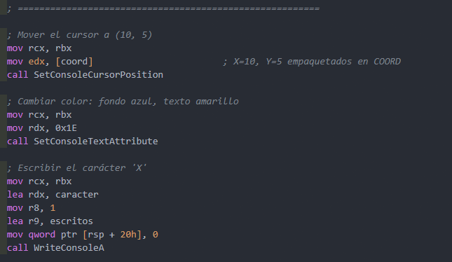
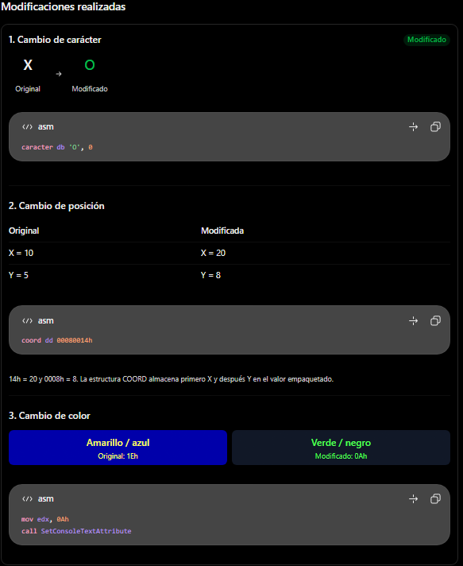
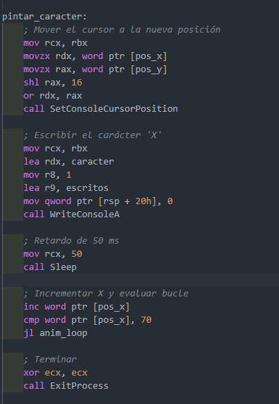
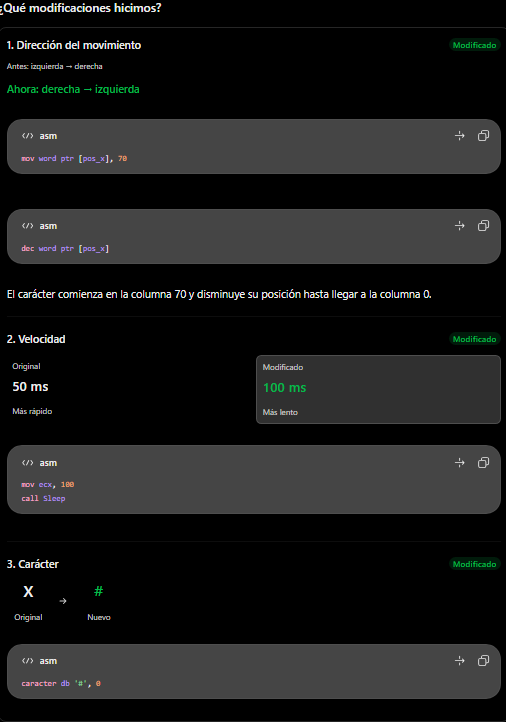

# Laboratorio 12 — Pintar un carácter y animarlo en consola

**Materia:** Lenguajes de Interfaz  
**Alumno:** Oscar Sebastián Valdez Barrios  
**Institución:** Instituto Tecnológico de Mexicali  
**Arquitectura:** x64  

## Objetivo

Desarrollar dos programas en lenguaje ensamblador x64 que utilicen funciones de la API de Windows para manipular la consola. El primer programa posiciona y muestra un carácter con atributos de color específicos; el segundo desplaza un carácter horizontalmente para producir una animación.

## Archivos incluidos

| Archivo | Descripción |
|---|---|
| `semana12.asm` | Muestra el carácter `X` en color amarillo sobre fondo azul, en la coordenada X=10, Y=5. |
| `semana12_anim.asm` | Desplaza el carácter `X` en color verde de izquierda a derecha sobre la fila 10 de la consola. |

## Herramientas y tecnologías

- Ensamblador x64.
- UASM64.
- GoLink.
- API de consola de Windows mediante `kernel32.dll`.

## Compilación y ejecución

Los siguientes comandos permiten ensamblar, enlazar y ejecutar cada programa desde una terminal de Windows configurada con UASM64 y GoLink.

### Parte 1 — Carácter en una posición y color determinados

```cmd
uasm64 -win64 semana12.asm
GoLink.exe semana12.obj kernel32.dll /fo semana12.exe /console /entry main
semana12.exe
```

### Parte 2 — Animación horizontal

```cmd
uasm64 -win64 semana12_anim.asm
GoLink.exe semana12_anim.obj kernel32.dll /fo semana12_anim.exe /console /entry main
semana12_anim.exe
```

## Desarrollo y funcionamiento

### Parte 1 — Escritura de un carácter

El programa realiza las siguientes operaciones:

1. `GetStdHandle` obtiene el identificador de la salida estándar de la consola.
2. `FillConsoleOutputCharacterA` escribe espacios para limpiar el contenido de la consola.
3. `FillConsoleOutputAttribute` establece los atributos iniciales de las celdas limpiadas.
4. `SetConsoleCursorPosition` coloca el cursor en la coordenada X=10, Y=5.
5. `SetConsoleTextAttribute` establece el atributo `1Eh`, correspondiente a texto amarillo sobre fondo azul.
6. `WriteConsoleA` escribe el carácter `X` en la posición seleccionada.

#### Estructura COORD

La estructura `COORD` está formada por dos valores de 16 bits: `X` (columna) y `Y` (fila). Para pasarla a las funciones de la API de Windows, ambos valores se empaquetan en un DWORD: Y ocupa los 16 bits superiores y X los 16 bits inferiores.

Para X=10 y Y=5:

```text
Y       = 0005h
X       = 000Ah
COORD   = 0005000Ah
```

### Parte 2 — Animación horizontal

El segundo programa utiliza las funciones de consola para desplazar un carácter a través de una fila:

1. Obtiene el identificador de la salida estándar y limpia la consola.
2. Establece el atributo `0Ah`, correspondiente al color verde.
3. Inicializa las variables `pos_x` y `pos_y`; la fila permanece en Y=10.
4. En cada iteración, posiciona el cursor en la coordenada anterior y escribe un espacio para borrar el carácter previo.
5. Construye la nueva coordenada a partir de la posición horizontal y la fila establecida.
6. Posiciona el cursor y escribe el carácter `X`.
7. Ejecuta `Sleep` durante 50 milisegundos para controlar la velocidad de desplazamiento.
8. Incrementa la posición horizontal hasta alcanzar el límite definido por el programa.

## Evidencias de ejecución

Las evidencias correspondientes a las pruebas de los programas se organizan con las siguientes referencias:

### Parte 1 – Ejecución original


### Parte 1 – Ejecución modificada


### Parte 2 – Ejecución original


### Parte 2 – Ejecución modificada



## Evidencias de ejecución

Las evidencias correspondientes a las pruebas de los programas se organizan con las siguientes referencias:

- `evidencias/parte1.png` — ejecución de la primera parte.
- `evidencias/parte1_modificada.png` — ejecución de la primera parte con parámetros modificados.
- `evidencias/parte2.png` — ejecución de la animación.
- `evidencias/parte2_modificada.png` — ejecución de la animación con parámetros modificados.

## Video demostrativo

**Enlace:** [Video demostrativo del Laboratorio 12](https://drive.google.com/drive/folders/1O7vnMBwKdOFhz6U1Tff52lD1bknMDAvS?usp=sharing)

El material audiovisual presenta la ejecución de los dos programas, describe sus operaciones principales y muestra modificaciones de los parámetros de funcionamiento.

## Consideraciones técnicas

- Los programas están destinados a ejecutarse en Windows de 64 bits.
- Las llamadas a funciones de la API de Windows siguen la convención de llamadas x64, incluyendo el espacio de reserva (*shadow space*) y el espacio correspondiente a los argumentos adicionales.
- La segunda parte declara las funciones de la API utilizadas para limpiar la consola.
- La limpieza considera 2000 celdas, equivalente a una consola de 80 columnas por 25 filas. Por ello, la dimensión de la ventana o del búfer de consola debe ser compatible con ese tamaño para que la limpieza cubra el área prevista.

## Uso de inteligencia artificial como herramienta de apoyo

Durante el desarrollo se utilizó ChatGPT como herramienta de apoyo para analizar los requisitos de la práctica, comprender el uso de las funciones de la API de Windows y revisar la estructura de los programas en ensamblador x64. La herramienta se empleó como apoyo para aclarar conceptos y proponer soluciones; la implementación y las pruebas de ejecución corresponden al trabajo realizado sobre los archivos del proyecto.

A continuación, se presentan prompts representativos del tipo de consultas utilizadas durante el desarrollo:

1. **Análisis de requisitos:**
   > Analiza las instrucciones del Laboratorio 12 de Lenguajes de Interfaz. Identifica los entregables, los requisitos de cada parte, las funciones de Windows que deben utilizarse y las evidencias solicitadas. Organiza el trabajo en una lista de verificación sin omitir requisitos.

2. **Comprensión de la API de Windows:**
   > Explica cómo utilizar `GetStdHandle`, `FillConsoleOutputCharacterA`, `FillConsoleOutputAttribute`, `SetConsoleCursorPosition`, `SetConsoleTextAttribute` y `WriteConsoleA` desde ensamblador x64. Describe los parámetros, el propósito de cada función y el orden adecuado de las llamadas.

3. **Representación de coordenadas:**
   > Explica la estructura `COORD` de la API de consola de Windows y cómo empaquetar los valores X e Y de 16 bits en un DWORD para pasarlos desde ensamblador. Utiliza como ejemplo X=10 y Y=5.

4. **Desarrollo de la primera parte:**
   > Propón una implementación en UASM x64 que limpie la consola, coloque el cursor en una coordenada determinada, establezca texto amarillo sobre fondo azul y escriba el carácter X. Utiliza las convenciones de llamada de Windows x64 y comenta las instrucciones relevantes.

5. **Desarrollo de la animación:**
   > Diseña un programa en UASM x64 que mueva horizontalmente el carácter X en una fila de la consola. En cada iteración debe borrar la posición anterior, dibujar el carácter en la nueva posición y utilizar `Sleep` para controlar la velocidad. Explica la lógica del ciclo y sus límites.

6. **Revisión técnica del código:**
   > Revisa este código ensamblador x64 que utiliza funciones de `kernel32.dll`. Comprueba la declaración de funciones externas, el paso de argumentos, el uso del espacio de pila, la construcción de las coordenadas y la lógica de limpieza. Señala posibles errores y justifica las correcciones.

7. **Preparación de la explicación:**
   > Elabora una explicación breve y técnica para presentar el Laboratorio 12. Describe el funcionamiento de cada programa, el propósito de `COORD`, los atributos de color, el borrado de la posición anterior y el efecto del retardo en la animación.

## Referencia

Laboratorio 12 — material e instrucciones proporcionados en la asignatura Lenguajes de Interfaz.
